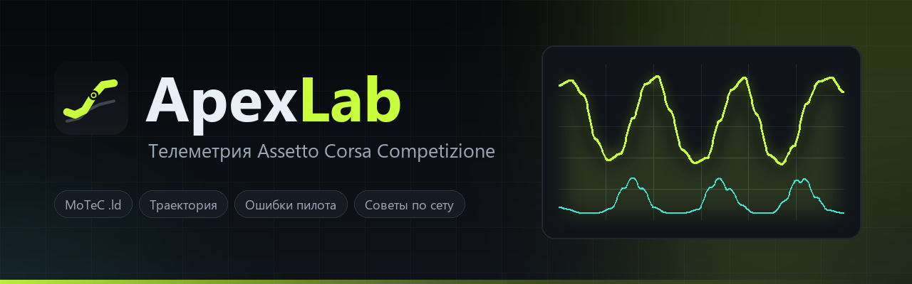

<p align="center">
  
</p>

<p align="center">
  <a href="https://github.com/LTW33/ApexLab/releases/latest"></a>
  <a href="https://github.com/LTW33/ApexLab/releases"></a>
  <a href="LICENSE"></a>
  
  
  
</p>

# ApexLab

**Локальная студия телеметрии для Assetto Corsa Competizione.**  
Читает логи MoTeC `.ld` напрямую, разбирает круги, показывает ошибки пилота и предлагает правки сета.  
Всё считается на твоём компьютере — без интернета, аккаунтов и облака.

---

## 📥 Скачать

| Файл | Описание |
|------|----------|
| **[ApexLab-2.0.0-win64.zip](https://github.com/LTW33/ApexLab/releases/download/v2.0.0/ApexLab-2.0.0-win64.zip)** | Архив с `ApexLab.exe` и инструкцией (23,1 МБ) |
| **[ApexLab.exe](https://github.com/LTW33/ApexLab/releases/download/v2.0.0/ApexLab.exe)** | Только исполняемый файл (23,3 МБ) |

> **SHA256**  
> `ApexLab-2.0.0-win64.zip` — `0B00D081D2B3F555BE52BF71F1D17AC6AE99E79AAFE90D05B9D902957C0F7B18`  
> `ApexLab.exe` — `EF343DB285256C68F4A56E9CCEA58C8AE8E4947C7D3479F882809FD27DF57CE4`

**Установка:** распакуй архив **целиком** в любую папку (не в `Program Files`), запусти `ApexLab\ApexLab.exe`. Python и библиотеки ставить не нужно — всё внутри exe.

---

## 🖥 Запуск из исходников

```cmd
run.bat            # релизный канал
run.bat beta       # бета-канал (эксперименты включены)
```

Требуется Python 3.11+. `run.bat` сам поставит `numpy` и `pywebview`.  
Если нет WebView2 — приложение откроется в браузере на `http://127.0.0.1:8765/`.

---

## 🎨 Оформление — семь тем

| Тема | Цвет | Акцент |
|------|------|--------|
| **Графит** | тёмно-серый металл | серебристый `#e4e7ea` |
| **Карбон** | ночной лайм | лайм `#c8ff3d` |
| **Полночь** | глубокий синий | циан `#35e0ff` |
| **Янтарь** | тёплый закат | оранжевый `#ffb340` |
| **Фиалка** | ночной фиолет | фиолет `#b98cff` |
| **День** | светлая | синий `#2358e6` |
| **Моно** | строгая чёрно-белая | чёрный `#111111` |

**Графит — тема по умолчанию.** Переключение: слева внизу, `Ctrl+Shift+T` или карточками в «Настройках».  
Тема применяется мгновенно: графики, карта трассы и нативное окно перекрашиваются на месте без перезагрузки.

---

## ⌨ Горячие клавиши

| Комбинация | Действие |
|------------|----------|
| `Ctrl+K` | Командная строка — поиск сессий, трасс, пилотов, разделов |
| `Ctrl+Shift+T` | Следующая тема |
| `Ctrl+B` | Свернуть/развернуть боковую панель |
| `Ctrl+E` | Сохранить текстовый отчёт о сессии |
| `Ctrl+P` | Печать текущего экрана |
| `Alt+1…5` | Вкладки внутри сессии |
| `F1` | Настройки и список горячих клавиш |

---

## 📊 Что внутри

| Раздел | Описание |
|--------|----------|
| **Гараж** | Все импортированные сессии: трасса, машина, дата, лучший круг, оценка пилота, ошибки. Дубликаты MoTeC схлопываются, битые логи пропускаются с причиной. |
| **Обзор** | Оценка пилота, темп, стабильность, торможение, тяга, баланс, плавность; графики скорости/газа/тормоза/передач и карта трассы с курсором. |
| **Траектория** | Сравнение линии круга с эталоном: карта с подсветкой отклонений, график отклонения по дистанции, разбор проблемных зон по поворотам (фаза, сторона, метрики, что делать). |
| **Круги** | Таблица кругов, чистые/невалидные, теги пита и выезда, выбор круга для разбора. |
| **Ошибки** | Блокировки колёс, пробуксовки, пробои подвески, перегрев тормозов, движение накатом — с привязкой к поворотам. |
| **Сет** | Разбор JSON-сета ACC, пересчёт кликов в игровые единицы, рекомендации «было → стало» под найденные проблемы. Импорт `.json` перетаскиванием. |
| **Пилоты** | Сводный профиль: радар техники, лучший круг по трассам, средние оценки. Имена пилотов задаются вручную (в логе ACC их нет). |
| **Сравнение** | Два круга бок о бок: дельта по дистанции, скорости, газ/тормоз, карты траекторий, таблица по поворотам. |
| **Настройки** | Папки ACC, статистика библиотеки, пересканирование, импорт, семь тем карточками, список горячих клавиш. |

> **Бета-канал** добавляет: **Эталоны** (отдельная вкладка для логов быстрых пилотов), **Серии** (объединение заездов одной трассы/машины/пилота) и **Разбор** (текстовый отчёт в стиле гоночного инженера).

---

## ⚙ Единицы в сете

ACC хранит setup в кликах, а гараж показывает физику. ApexLab пересчитывает клики в игровые значения:

| Параметр | В игре | В ApexLab |
|----------|--------|-----------|
| Давление шин | psi (холодное) | **psi** |
| Развал / схождение / кастор | градусы | **°** |
| Пружины | Н/мм | **Н/мм** |
| Клиренс | мм | **мм** |
| Отбойник | Н | **Н** |
| Баланс тормозов | % | **%** |
| Преднагрузка дифференциала | Нм | **Нм** |
| Стабилизаторы, амортизаторы, крыло, воздуховоды | клики | **клики** |

Поддерживается 46 машин ACC (GT3, GT4, Cup, TCX, M2 CS Racing). Для модов — предупреждение и кликовые значения.

---

## 📐 Как считается траектория

1. Восстановление по `ROTY` (рыскание) + скорость.
2. Пересэмплирование с шагом **5 м** по дистанции.
3. Отклонение = расстояние от твоей линии до эталона по нормали.
4. Дрейф интегрирования снимается полиномом + скользящее среднее → метры показывают локальные различия в поворотах.

Эталон по умолчанию — самый быстрый чистый круг на трассе. Его можно сменить в списке над картой.

---

## 📂 Где лежат данные

| Данные | Путь |
|--------|------|
| Логи ACC | `Документы\Assetto Corsa Competizione\MoTeC` (`.ld`) |
| Сеты ACC | `Документы\Assetto Corsa Competizione\Setups` (`.json`) |
| Отчёты | Куда укажешь в диалоге (или «Загрузки» в браузере) |
| Импортированные сеты | `data\setups` рядом с exe / `apexlab\data\setups` в исходниках |
| Кэш разбора | `data\cache` / `apexlab\data\cache` |
| Библиотека, эталонные логи, обучение | `data\library.json` / `apexlab\data\library.json` |
| Оформление и геометрия окна | `data\ui.json` / `apexlab\data\ui.json` |
| Журнал запуска | `data\apexlab.log` / `apexlab\data\apexlab.log` |

Исходные логи и сеты — **только чтение**. `data` можно удалить — приложение соберёт всё заново.

---

## ⚠ Известные ограничения

- **SmartScreen** — сборка не подписана: «Подробнее» → «Выполнить всё равно».
- Машины вне таблицы пересчёта — давление/схождение/кастор/пружины/клиренс/баланс в кликах.
- Нет `ROTY` в логе → траектория недоступна (вкладка покажет причину).
- Круги разной длины (выезд, пит, неполный) по дистанции не сравниваются.
- ACC не пишет имя пилота → сессии переименовываешь вручную.

---

## 🛠 Сборка

```cmd
python -m pip install pyinstaller
python apexlab\tools\build_exe.py          # релиз  → release\ApexLab-2.0.0-win64.zip
python apexlab\tools\build_exe.py beta     # бета   → release\beta\ApexLab-2.1.0-beta-win64.zip
```

Скрипт рисует иконку, собирает однофайловый `ApexLab.exe` (без консоли, с иконкой и темами) и пакует zip.

---

## 🗺 Дорожная карта

См. [ROADMAP.md](ROADMAP.md) — задачи разделены на **Релиз** (полировка) и **Бета** (эксперименты).

---

## 📄 Лицензия

[MIT License](LICENSE) — свободное использование, модификация и распространение.

---

## 🔗 Ссылки

- **Репозиторий:** https://github.com/LTW33/ApexLab
- **Релизы:** https://github.com/LTW33/ApexLab/releases
- **Issues:** https://github.com/LTW33/ApexLab/issues